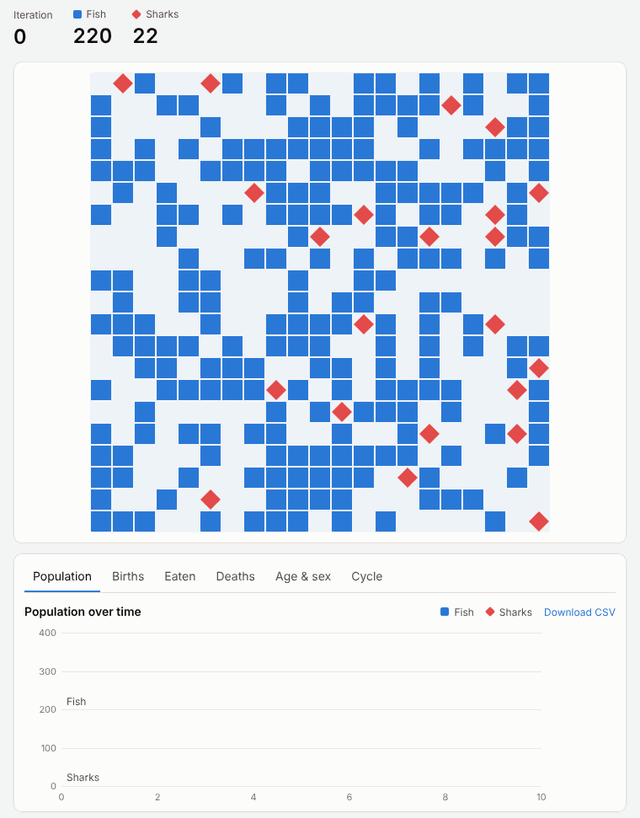
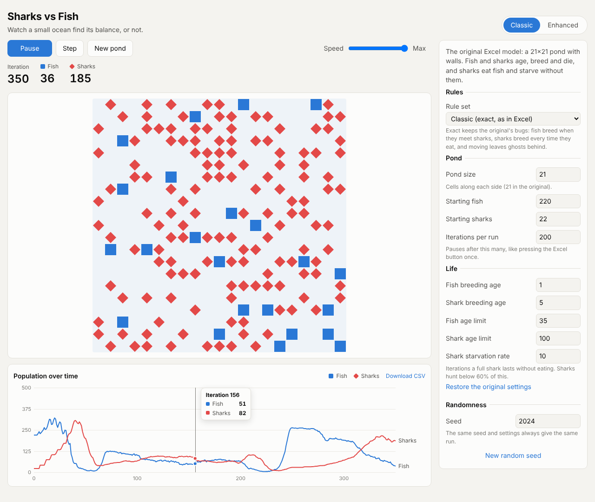
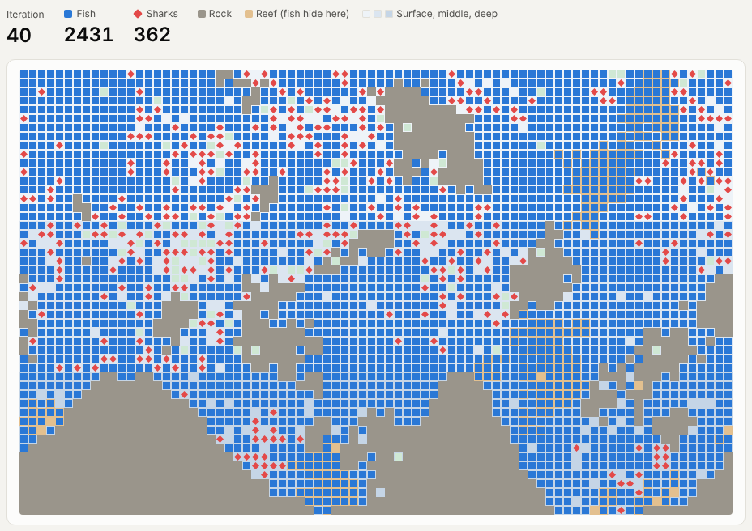
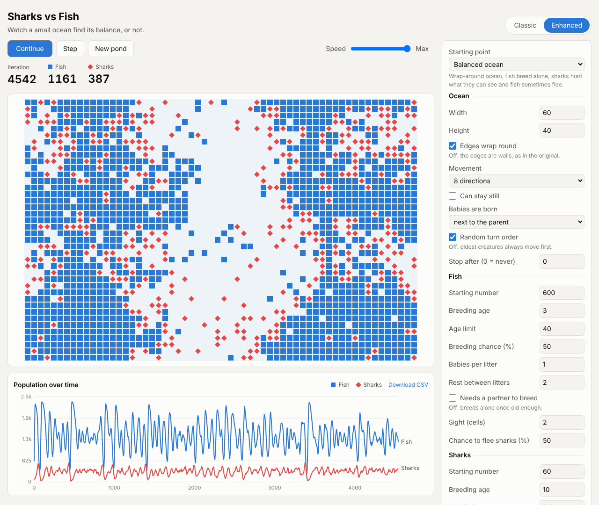
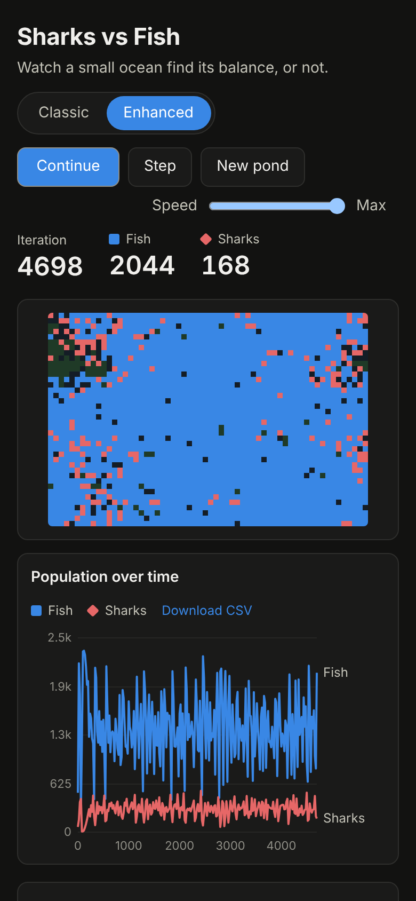
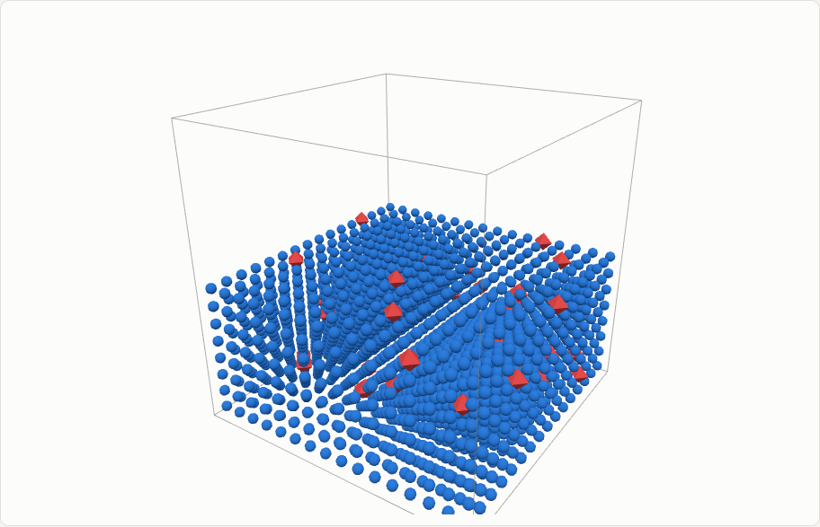
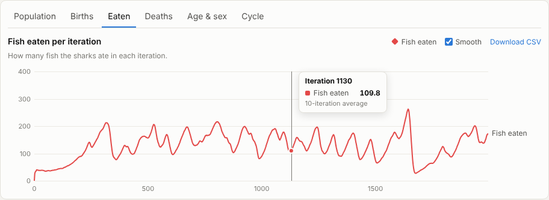
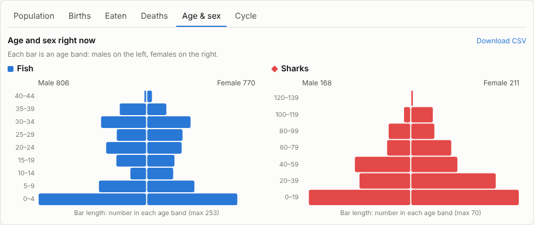
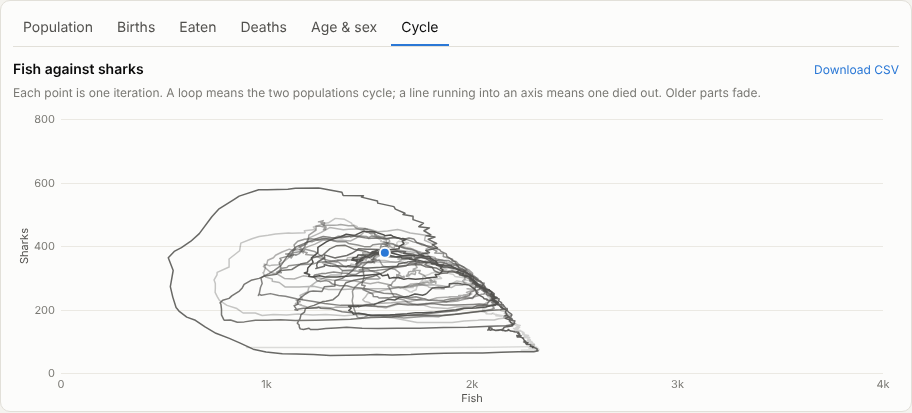
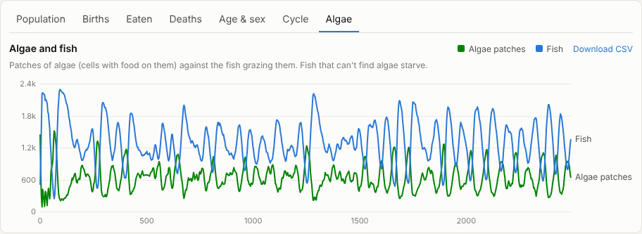

# Sharks vs Fish

A predator-prey simulation in the browser. Fish and sharks live in a grid ocean: they age, breed and die, sharks eat fish, and sharks starve without them. Watch the populations over time to see whether the ocean finds a balance.

It started life as an Excel/VBA workbook (`SnF - v4.xls`). This is a rebuild that keeps the original model and adds a lot more to play with.

**Play it:** https://nichevo.github.io/SharksvsFish/





## Modes

### Classic
The original model, ported line by line from the VBA (`original/Module1.bas`): a 21×21 pond with walls, 220 fish and 22 sharks, and the same ages, breeding and starvation settings. It runs in blocks of 200 iterations, like pressing the button in Excel.

There are two rule sets:

- **Classic (exact)** reproduces the spreadsheet, bugs included:
  - The breeding check is inverted (`Family <> Family`), so fish breed when they bump into an adult shark, and fish meeting fish never breed.
  - Sharks breed every time they eat, because the emptied cell counts as "a different family".
  - A moving creature clears its *new* cell in the location map instead of its old one. That leaves a "ghost" behind, and its real cell looks empty to others, so creatures can share cells and sharks can eat ghosts. The map is rebuilt at the start of each 200-iteration run, as Excel did when it read the `Data` sheet back in.
  - A fed shark looking for a mate finds itself, so it doesn't move.
- **Intended** fixes those bugs: like breeds with like, moves update the map properly, and sharks only breed with other sharks. (With the original numbers the sharks usually die out: in the spreadsheet, eating was what kept them breeding.)

Excel's random numbers can't be reproduced, so individual runs differ from the spreadsheet, but the overall behaviour matches.

### Enhanced
A cleaner model with many more settings, and some presets to start from:

- **Ocean:** size, wrap-around edges or walls, 8 or 4 directions of movement, whether creatures can stay still, where babies are born, turn order, and a stop limit.
- **Fish and sharks:** starting numbers, breeding age, age limit, breeding chance, litter size, rest between litters, whether a partner is needed, and how far they can see.
- **Sharks:** energy (starting, maximum, per fish eaten), the hunger level at which they hunt, the energy needed to breed, and whether they move into the fish's cell.
- **Fish:** the chance they swim away from sharks they can see.
- **Algae:** an optional food chain where fish must graze algae, which grows back over time.
- **Sea floor:** undersea mountains rising from the bottom, rocks in open water, and reefs. Nothing can swim through rock. Fish can hide in reefs: sharks can't swim in or see them there, and most attacks on a hiding fish fail.
- **Depth zones:** surface, middle and deep bands, each with its own fish and shark breeding, shark sight, energy use and algae growth. By default the surface is bright (more breeding and algae, sharks see further), and the deep is dark and cold (no algae, sharks see less, everything burns energy more slowly). A table under the totals counts fish and sharks in each zone.

Sea floor and depth zones are off unless you switch them on, so the other presets run exactly as before.

Presets: *Balanced ocean*, *Wa-Tor* (Dewdney's 1984 rules), *Pairs only*, *Algae food chain* and *Reefs and depths*.







Enhanced mode can also give creatures a sex (**Separate males and females**). It is off by default. When it is on, partners must be male and female, a species that breeds alone only has young through its females, and the pond and age pyramids show males in a darker shade and females in a lighter one.

### 3D cube

The Enhanced rules in a cube of water instead of a flat grid (16×16×16 by default). Creatures move, hunt, flee and find partners in 26 directions, or 6 with diagonals off, so they can go up and down as well as across. The sides can wrap round; the surface and seabed are always walls. Drag the cube to turn it, scroll or pinch to zoom, and use **Cut away top levels** to look inside. Charts and totals work as in the other modes.

Sharks find fish much more easily with 26 neighbours, so the 3D defaults have sharks breeding less often and dying younger than in Enhanced. The 3D view uses [Three.js](https://threejs.org/), which is only downloaded when you open this mode.



## Charts

Under the pond, the tabs show:

- **Population:** fish and sharks over time.
- **Births**, **Eaten** and **Deaths:** what happened in each iteration, with optional 10-iteration smoothing.
- **Age & sex:** an age pyramid for each species, with males on the left and females on the right. Classic mode (and Enhanced with sexes off) shows ages only.
- **Cycle:** fish plotted against sharks. A stable ocean draws loops, and a crash runs into an axis.
- **Algae** (only when *Fish must eat algae* is on): algae patches against fish over time. The **Eaten** chart also adds algae grazed per iteration, and the totals table gets an algae row.

A **Totals so far** table shows births, deaths by cause (eaten, old age, starved), the number alive now and the peak for each species. **Download CSV** includes every series.









Every run uses a **seed**, so the same seed and settings always give the same run.

## Running it on your own computer

There are three ways, from easiest to most flexible.

1. **Download one file (no install).** On the [live site](https://nichevo.github.io/SharksvsFish/), click **Download to run offline**, or go straight to https://nichevo.github.io/SharksvsFish/sharks-vs-fish.html and save the page. You get a single `sharks-vs-fish.html` file with everything inside it. Double-click it to open it in any modern browser, with no internet or server needed.
2. **Build the file yourself.** Install [Node.js](https://nodejs.org/) (version 20 or newer), then in this folder run `npm install` and `npm run build`. The same single file appears at `dist/sharks-vs-fish.html`, and the normal multi-file site is in `dist/`.
3. **Run the development server** to change the code and see it update live:

   ```sh
   git clone https://github.com/Nichevo/SharksvsFish.git
   cd SharksvsFish
   npm install
   npm run dev
   ```

   Then open the address it prints (usually http://localhost:5173). Use `npm run preview` to serve the production build locally instead.

## Development

```sh
npm install
npm run dev      # local server with hot reload
npm test         # engine tests (vitest)
npm run build    # type-check and build to dist/, plus the offline dist/sharks-vs-fish.html
```

The code layout:

- `src/engine/`: the simulations, with no browser code. `classic.ts` is the VBA port, `enhanced.ts` is the new model, and `presets.ts` holds the enhanced presets. Both engines implement the `Simulation` interface in `types.ts`.
- `src/ui/fields.ts`: the settings forms are generated from these lists, so a new engine option needs only one line here.
- `src/ui/chart.ts`: the population chart.
- `src/main.ts`: wires it all together.

## Deploying

`.github/workflows/deploy.yml` runs the tests and builds on every push and pull request, and deploys `main` to GitHub Pages. To switch it on, go to **Settings → Pages** and set **Source** to **GitHub Actions**.
